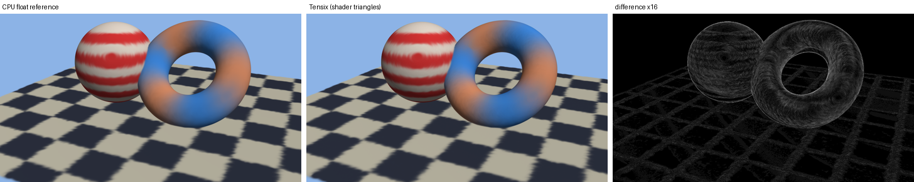

# tt-raster

A tile-based software rasterizer for Tenstorrent Blackhole Tensix cores, checked pixel by pixel against a CPU reference. Work is planned in `docs/PLAN.md`; evidence and decisions are in `docs/FINDINGS.md` and measurements in `docs/PERF.md`.

## Layout

The repository is split by who uses what, so that someone who only wants the renderer can take `core/` and nothing else.

```
core/       the renderer: frame format, CPU reference, shader interpreter, the Tensix renderer, the C frame API (libttraster.so),
            its tools, tests and the Phase 0 device spikes. No OpenGL, Vulkan, Isaac Lab or Newton code.
api/        graphics API drivers on top of the core
  gl/         OpenGL: the softpipe fast path for Mesa (patch, driver files, tests)
  vulkan/     Vulkan (lavapipe): see api/vulkan/README.md
plugins/    consumers of the core that are not graphics APIs
  isaaclab/   batched-camera scene renderer (libttraster_scene.so), Python bindings, Newton bridge, Isaac Lab renderer package
  gaussian/   3D Gaussian Splatting: projection, float CPU reference, the splats through any core backend, PLY (libttraster_gaussian.so, ttraster_gs)
docs/       plans, findings, measurements, the OpenGL/Vulkan evaluation, Gaussian splatting (GAUSSIANS.md)
scripts/    build, test and run scripts for all of the above
```

| Part | Where | Needs a device |
| --- | --- | --- |
| Frame format, triangle setup, binning, CPU reference, int64 oracle, scenes, image tools | `core/src/ttraster/` | no |
| `ttr_render` (render a scene, write PNG and golden manifest), `ttr_diff` (image diff with heatmap) | `core/tools/` | no |
| Tests and golden images | `core/tests/` | no |
| Phase 0 hardware spikes | `core/spikes/` | yes (tt-metal v0.81.1) |
| Tensix renderer: host side, kernels, multi-chip driver | `core/src/tensix/` | yes |
| C frame API for drivers (`ttr_context_*`, `ttr_frame_*`) | `core/include/ttraster/ttraster.h` | yes (or CPU backend) |
| `ttr_device` (render on a chip, compare with the reference), `ttr_multichip` (1/2/4/8 chips) | `core/tools/` | yes |
| OpenGL: softpipe fast path for Mesa (patch, driver file, test scene) | `api/gl/` | yes (or CPU backend) |
| Isaac Lab renderer backend, scene layer, Newton bridge | `plugins/isaaclab/` | yes (or CPU backend) |

```
scripts/build.sh                                  # host library, tools, tests
scripts/test.sh                                   # all host tests, about 10 s
scripts/test_sanitizers.sh                        # the same under AddressSanitizer and UBSan (and the fuzz on chips, with TT_METAL_HOME)
TT_METAL_HOME=/path/to/tt-metal scripts/build.sh  # also the device spikes
scripts/run.sh 0 build/core/spikes/a_lane_map/spike_a  # run a device program on node 0 only
scripts/test_device.sh                            # on a chip: scenes against the reference, 1/2/4/8 chips, shader instruction accuracy, random shader programs
```

The host part needs a C++20 compiler, CMake, Ninja and zlib.

## Results: Tensix against the CPU reference

Every image below is rendered at 1920 x 1088 on one Blackhole chip (all 120 worker cores) and compared pixel by pixel with the CPU reference. Each picture shows, left to right, **CPU reference | Tensix device | difference** (black = identical; any differing pixel would show up red to yellow). The images are downscaled 4x for the page; the comparison itself is at full resolution, and the committed full-size reference images are in `core/tests/golden/`.

| Scene | Pixels that differ | Device time (1 chip) | Comparison |
| --- | --- | --- | --- |
| one smooth triangle | 0 of 2,088,960 | 0.6 ms |  |
| 96-triangle fan (shared edges) | 0 | 0.9 ms |  |
| jittered grid mesh, 4,080 triangles (watertight: every pixel hit once) | 0 | 0.8 ms |  |
| 24 interpenetrating triangles | 0 | 0.7 ms |  |
| one screen-covering triangle (guard-band clipping) | 0 | 0.6 ms |  |
| coplanar triangles, `LESS_EQUAL` depth ties | 0 | 0.7 ms |  |
| 10,000 tiny triangles | 0 | 0.6 ms |  |
| 10,000 random triangles | 0 | 2.7 ms |  |

Device time is the minimum over repeated warm frames, colour plane only (`docs/PERF.md`). Whole-frame time including host setup, upload and read-back is 12 to 16 ms on one chip and 6 to 7 ms on eight chips, with the eight-chip image bit-identical to the one-chip image.

Regenerate: `scripts/run.sh 0 build/core/tools/ttr_device all --mode grid --colour-only --png DIR`, then `build/core/tools/ttr_compare DIR/<scene>_reference.png DIR/<scene>_device.png docs/images/<scene>.png`.

## Track I: rendering for Isaac Lab, compared with Newton Warp

`libttraster` (`core/include/ttraster/ttraster.h`, Python binding in `plugins/isaaclab/python/ttraster`) renders one camera per environment, all environments in one rasterizer run, and returns depth, shape ids, albedo, shaded RGB and normals with the conventions of Isaac Lab and Newton's Warp renderer. `plugins/isaaclab/validation/` renders the same cartpole-like scene with Newton's own ray tracer (on the CPU, through Warp) and with libttraster on a Tensix chip and compares them.

A simulated cartpole, two environments side by side: the physics is MuJoCo Warp (through Newton's `SolverMuJoCo`, on the CPU), and every frame is rendered from the same body transforms by Newton's Warp ray tracer (left of each pair) and by libttraster on a Tensix chip (right): RGB, depth and normals, 96 x 96 pixels, Isaac Lab background colour:


(`scripts/run.sh 5 venv-newton/bin/python plugins/isaaclab/validation/cartpole_gif.py OUT.gif` records it; the numbers against Newton are in the table below.)

| Metric against Newton Warp | Value |
| --- | --- |
| Pixels with the same shape id | 99.6% |
| Depth, median relative error | 1.7e-4 |
| Normals, mean angle error | 0.05 degrees |
| RGB PSNR over pixels both renderers hit | 49 dB |

Speed: 1,024 environments of 96 x 96 take about 24 ms per frame for depth on one chip with an x8 link (43 ms on one of the x1 chips), of which the Tensix kernels are 1.4 ms; with two frames in flight (`Scene.submit` / `Scene.collect`, one frame of latency) the steady state is about 19 ms per frame, 54,000 images/s (eight chips: 17.7 ms). The rest is host work and PCIe, which is why eight chips do not help much yet (`docs/PERF.md`). An Isaac Lab `BaseRenderer` backend (`plugins/isaaclab/isaaclab_ttraster`) and a Newton-model bridge (`plugins/isaaclab/python/ttraster/newton_bridge.py`) exist and agree with Newton's tiled camera on real Newton data (`scripts/test_python.sh`); the backend has not run inside a live Isaac Lab (no PyTorch/CUDA here), and per-pixel lighting and the training run are not done. `docs/FINDINGS.md` has the interface contract, the measurements and what is missing.

## OpenGL through Mesa (Track G)

Mesa's softpipe driver, patched (`mesa/`), hands the rasterization of whole frames to tt-raster: a real OpenGL program (GL 3.3 compatibility profile) draws through Mesa's frontend, GLSL vertex shaders and fixed-function state run on the host as before, and the triangles are rasterized on a Blackhole chip. Depth tests and writes, alpha blending and the common blend factors work per draw, and GLSL fragment shaders with arithmetic run on the chip too (a translator from Mesa's TGSI to the instruction set of a per-pixel interpreter on the SFPU: per-pixel lighting, procedural patterns from `gl_FragCoord`, uniforms, `discard`, conditionals, unrolled loops); draws the fast path cannot do (textures, stencil, lines, other blend factors, loops with run-time bounds) run on softpipe, so output stays correct. glxgears at 1920 x 1080: 160 FPS on a Tensix chip, 31 FPS on stock softpipe; at 300 x 300 stock softpipe is faster (571 against 333 FPS), because a chip frame has about 2 ms of fixed latency.


```
scripts/build_mesa.sh && scripts/run_gl.sh 5 glxgears -geometry 1920x1080
scripts/test_gl.sh      # image comparisons against stock softpipe, also random GLSL shaders and random GL frames (CPU backend, and a chip)
```


(`api/gl/tests/record_gears.py` records it; the FPS in the labels are glxgears' own, measured while both ran.)


Against stock softpipe about 2 % of the pixels differ by one colour level and 0.02 % by more (triangle edge pixels); between the CPU backend and the chip only perspective-interpolated colours differ, by one level. This needed perspective-correct colour interpolation in the rasterizer (`Triangle::perspective`, reference and Tensix kernel). It is OpenGL for a subset of programs, not a conformant driver and not Vulkan; `api/gl/README.md` lists what is and is not accepted and `docs/FINDINGS.md` ("Track G") has the details.

## OpenGL 4.6 and Vulkan 1.4 on the CPU, with a Tensix offload

`scripts/build_mesa.sh --llvm` builds Mesa's conformant CPU drivers next to the softpipe `tensix` driver: llvmpipe (OpenGL 4.6 compatibility) and lavapipe (Vulkan 1.4, `conformanceVersion` 1.3.1.1 as it reports itself), so every OpenGL and Vulkan program runs; `scripts/run_vk.sh`, `scripts/run_gl.sh --driver llvmpipe`. On top, a Tensix offload hooks llvmpipe's set-up stage (`api/gl/llvmpipe_tensix`): whole frames of untextured triangles with depth test, simple blending and straight-line fragment shaders (llvmpipe's NIR through `nir_to_tgsi` to the shader instruction set, optionally compiled to SFPI with `TTR_SHADER_COMPILE=1`) are rasterized on a chip, and any draw it cannot take makes llvmpipe draw the rest, so images are always right: `scripts/test_lp.sh` compares 40 OpenGL and Vulkan cases (including an X11 swapchain) against llvmpipe and lavapipe alone. The Khronos Vulkan CTS 1.4.7.1 (`scripts/run_cts.sh`) passes the same cases with the offload, on the CPU backend and on a chip, as with lavapipe alone for every drawing group run (about 110,000 passes on the CPU backend in `draw`, `rasterization`, `fragment_operations`, `dynamic_state`, `ubo`, `glsl`, `clipping` and `renderpasses`), except four `output_location` cases that compare an offloaded render with an llvmpipe one bit for bit (one colour level apart at exact x.5 values); the CTS also found and fixed two real offload bugs (a shader's depth write was dropped; a frame was never opened for `loadOp = LOAD`). Several processes share a tray two ways: `TTR_DEVICE_POOL=4,5` (or `scripts/run.sh pool:4,5`) gives each process the first free chip and the next one runs on the CPU; or a device server (`scripts/serverd.sh <node>`, `core/tools/ttr_serverd`) owns one chip and any number of client processes with `TTR_SERVER=<socket>` send it their frames, a client whose server is missing or hung finishes the frame on the CPU, and the supervisor resets the chip and restarts the server (`scripts/test_serverd.sh`). `scripts/cts_farm.py` shards the CTS over the chips of the tray (all twelve drawing groups, 168,980 cases, in 4.4 minutes on eight chips: no failure beyond the 36 known ones; `scripts/cts_nightly.sh` is the cron wrapper). Compiled-shader kernels take seconds to build the first time: `TTR_SHADER_RECORD=<file>` records the program sets of a run and `ttr_prewarm <file>` (or `TTR_SHADER_WARM=<file>` at start-up) fills the kernel cache so that the first frame does not stall (8.9 s down to 0.8 s). A software texture unit was measured and not built (`docs/EVALUATION_GL_VULKAN.md`: one chip gathers texels at 2.1 Gpixel/s at best, 64 llvmpipe threads sample at 3.0). Measured at 1920 x 1080: one chip with compiled shaders beats 64 lavapipe threads from about 8 full-screen layers of a 131-instruction shader (47.9 against 67.4 ms at 32 layers); geometry-heavy and small frames lose or tie. The evaluation, with what is and is not possible (100 % API coverage on the CPU path: yes; GPU-class speed: no), is `docs/EVALUATION_GL_VULKAN.md`; Vulkan is `api/vulkan`.

## Gaussian splatting

`plugins/gaussian` renders 3D Gaussian Splatting scenes on top of the core (`docs/GAUSSIANS.md`): the reference implementation's projection (EWA, spherical harmonics up to degree 3), a float CPU renderer that is the oracle (and, on this host, the fast path: 800,000 Gaussians at 1280 x 720 in 0.6 s on 64 threads), the same splats drawn as shader triangles through any backend of the core, and PLY reading and writing. On a chip the splats render correctly (PSNR 51 dB against the float reference at 50,000 Gaussians, 41 dB at 800,000, where the 8-bit target loses faint splats) but 1.5 to 3.5 times slower than the CPU: Gaussian scenes are long per-pixel arithmetic lists, the workload the chip is worst at, so the Tensix path is a measured second backend, not the fast one.



