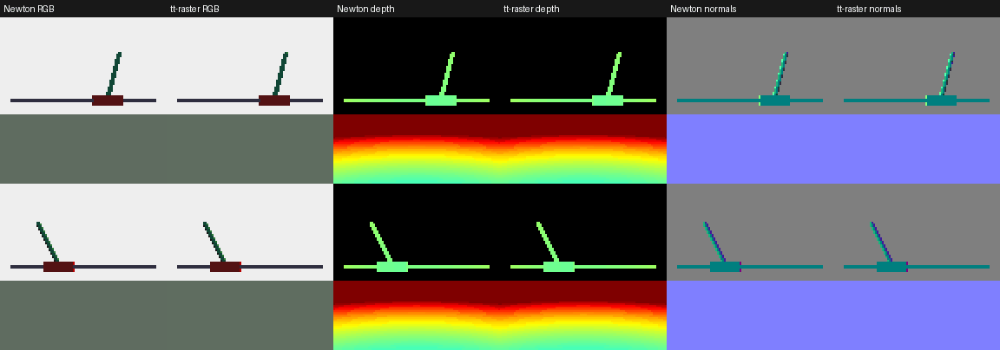
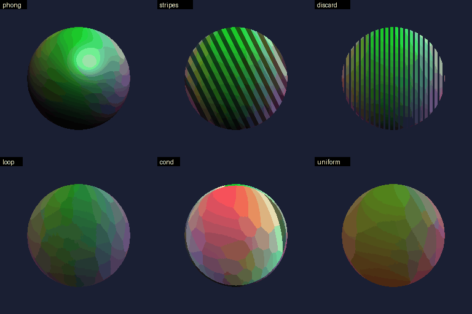
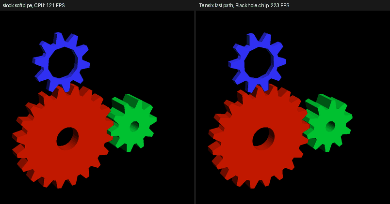
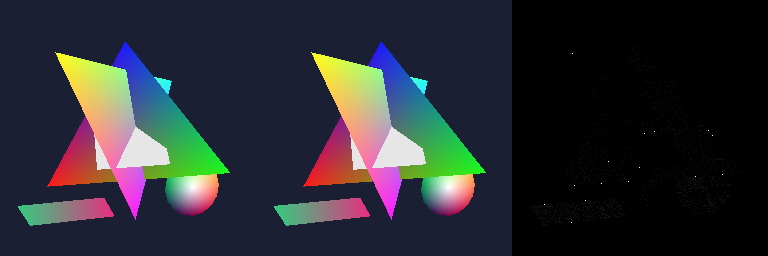

# tt-raster

A tile-based software rasterizer for Tenstorrent Blackhole Tensix cores, checked pixel by pixel against a CPU reference. Work is planned in `docs/PLAN.md`; evidence and decisions are in `docs/FINDINGS.md` and measurements in `docs/PERF.md`.

| Part | Where | Needs a device |
| --- | --- | --- |
| Frame format, triangle setup, binning, CPU reference, int64 oracle, scenes, image tools | `src/ttraster/` | no |
| `ttr_render` (render a scene, write PNG and golden manifest), `ttr_diff` (image diff with heatmap) | `tools/` | no |
| Tests and golden images | `tests/` | no |
| Phase 0 hardware spikes | `spikes/` | yes (tt-metal v0.81.1) |
| Tensix renderer: host side, kernels, multi-chip driver | `src/tensix/` | yes |
| `ttr_device` (render on a chip, compare with the reference), `ttr_multichip` (1/2/4/8 chips) | `tools/` | yes |
| Isaac Lab renderer backend, Newton bridge | `integrations/`, `python/` | yes (or CPU backend) |
| OpenGL: softpipe fast path for Mesa (patch, driver file, test scene) | `mesa/` | yes (or CPU backend) |

```
scripts/build.sh                                  # host library, tools, tests
scripts/test.sh                                   # all host tests, about 10 s
scripts/test_sanitizers.sh                        # the same under AddressSanitizer and UBSan (and the fuzz on chips, with TT_METAL_HOME)
TT_METAL_HOME=/path/to/tt-metal scripts/build.sh  # also the device spikes
scripts/run.sh 0 build/spikes/a_lane_map/spike_a  # run a device program on node 0 only
scripts/test_device.sh                            # on a chip: scenes against the reference, 1/2/4/8 chips, shader instruction accuracy, random shader programs
```

The host part needs a C++20 compiler, CMake, Ninja and zlib.

## Results: Tensix against the CPU reference

Every image below is rendered at 1920 x 1088 on one Blackhole chip (all 120 worker cores) and compared pixel by pixel with the CPU reference. Each picture shows, left to right, **CPU reference | Tensix device | difference** (black = identical; any differing pixel would show up red to yellow). The images are downscaled 4x for the page; the comparison itself is at full resolution, and the committed full-size reference images are in `tests/golden/`.

| Scene | Pixels that differ | Device time (1 chip) | Comparison |
| --- | --- | --- | --- |
| one smooth triangle | 0 of 2,088,960 | 0.6 ms |  |
| 96-triangle fan (shared edges) | 0 | 0.9 ms |  |
| jittered grid mesh, 4,080 triangles (watertight: every pixel hit once) | 0 | 0.8 ms |  |
| 24 interpenetrating triangles | 0 | 0.7 ms |  |
| one screen-covering triangle (guard-band clipping) | 0 | 0.6 ms |  |
| coplanar triangles, `LESS_EQUAL` depth ties | 0 | 0.7 ms |  |
| 10,000 tiny triangles | 0 | 0.6 ms |  |
| 10,000 random triangles | 0 | 2.7 ms |  |

Device time is the minimum over repeated warm frames, colour plane only (`docs/PERF.md`). Whole-frame time including host setup, upload and read-back is 12 to 16 ms on one chip and 6 to 7 ms on eight chips, with the eight-chip image bit-identical to the one-chip image.

Regenerate: `scripts/run.sh 0 build/tools/ttr_device all --mode grid --colour-only --png DIR`, then `build/tools/ttr_compare DIR/<scene>_reference.png DIR/<scene>_device.png docs/images/<scene>.png`.

## Track I: rendering for Isaac Lab, compared with Newton Warp

`libttraster` (`include/ttraster/ttraster.h`, Python binding in `python/ttraster`) renders one camera per environment, all environments in one rasterizer run, and returns depth, shape ids, albedo, shaded RGB and normals with the conventions of Isaac Lab and Newton's Warp renderer. `validation/` renders the same cartpole-like scene with Newton's own ray tracer (on the CPU, through Warp) and with libttraster on a Tensix chip and compares them.

A simulated cartpole, two environments side by side: the physics is MuJoCo Warp (through Newton's `SolverMuJoCo`, on the CPU), and every frame is rendered from the same body transforms by Newton's Warp ray tracer (left of each pair) and by libttraster on a Tensix chip (right): RGB, depth and normals, 96 x 96 pixels, Isaac Lab background colour:



(`scripts/run.sh 5 venv-newton/bin/python validation/cartpole_gif.py OUT.gif` records it; the numbers against Newton are in the table below.)

| Metric against Newton Warp | Value |
| --- | --- |
| Pixels with the same shape id | 99.6% |
| Depth, median relative error | 1.7e-4 |
| Normals, mean angle error | 0.05 degrees |
| RGB PSNR over pixels both renderers hit | 49 dB |

Speed: 1,024 environments of 96 x 96 take about 24 ms per frame for depth on one chip with an x8 link (43 ms on one of the x1 chips), of which the Tensix kernels are 1.4 ms; with two frames in flight (`Scene.submit` / `Scene.collect`, one frame of latency) the steady state is about 19 ms per frame, 54,000 images/s (eight chips: 17.7 ms). The rest is host work and PCIe, which is why eight chips do not help much yet (`docs/PERF.md`). An Isaac Lab `BaseRenderer` backend (`integrations/isaaclab_ttraster`) and a Newton-model bridge (`python/ttraster/newton_bridge.py`) exist and agree with Newton's tiled camera on real Newton data (`scripts/test_python.sh`); the backend has not run inside a live Isaac Lab (no PyTorch/CUDA here), and per-pixel lighting and the training run are not done. `docs/FINDINGS.md` has the interface contract, the measurements and what is missing.

## OpenGL through Mesa (Track G)

Mesa's softpipe driver, patched (`mesa/`), hands the rasterization of whole frames to tt-raster: a real OpenGL program (GL 3.3 compatibility profile) draws through Mesa's frontend, GLSL vertex shaders and fixed-function state run on the host as before, and the triangles are rasterized on a Blackhole chip. Depth tests and writes, alpha blending and the common blend factors work per draw, and GLSL fragment shaders with arithmetic run on the chip too (a translator from Mesa's TGSI to the instruction set of a per-pixel interpreter on the SFPU: per-pixel lighting, procedural patterns from `gl_FragCoord`, uniforms, `discard`, conditionals, unrolled loops); draws the fast path cannot do (textures, stencil, lines, other blend factors, loops with run-time bounds) run on softpipe, so output stays correct. glxgears at 1920 x 1080: 160 FPS on a Tensix chip, 31 FPS on stock softpipe; at 300 x 300 stock softpipe is faster (571 against 333 FPS), because a chip frame has about 2 ms of fixed latency.



```
scripts/build_mesa.sh && scripts/run_gl.sh 5 glxgears -geometry 1920x1080
scripts/test_gl.sh      # image comparisons against stock softpipe, also random GLSL shaders and random GL frames (CPU backend, and a chip)
```



(`mesa/tests/record_gears.py` records it; the FPS in the labels are glxgears' own, measured while both ran.)



Against stock softpipe about 2 % of the pixels differ by one colour level and 0.02 % by more (triangle edge pixels); between the CPU backend and the chip only perspective-interpolated colours differ, by one level. This needed perspective-correct colour interpolation in the rasterizer (`Triangle::perspective`, reference and Tensix kernel). It is OpenGL for a subset of programs, not a conformant driver and not Vulkan; `mesa/README.md` lists what is and is not accepted and `docs/FINDINGS.md` ("Track G") has the details.


