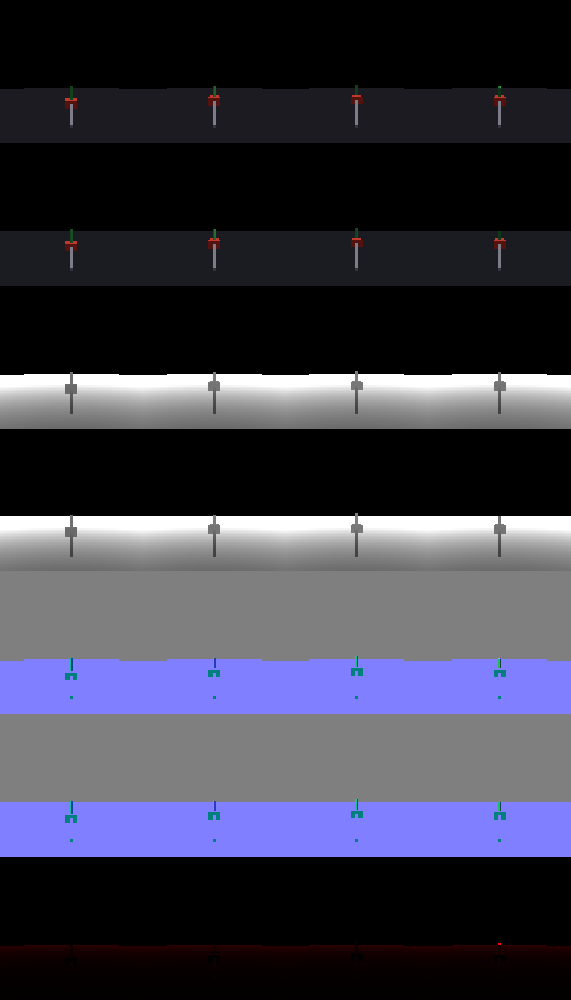

# tt-raster

A tile-based software rasterizer for Tenstorrent Blackhole Tensix cores, checked pixel by pixel against a CPU reference. Work is planned in `docs/PLAN.md`; evidence and decisions are in `docs/FINDINGS.md` and measurements in `docs/PERF.md`.

| Part | Where | Needs a device |
| --- | --- | --- |
| Frame format, triangle setup, binning, CPU reference, int64 oracle, scenes, image tools | `src/ttraster/` | no |
| `ttr_render` (render a scene, write PNG and golden manifest), `ttr_diff` (image diff with heatmap) | `tools/` | no |
| Tests and golden images | `tests/` | no |
| Phase 0 hardware spikes | `spikes/` | yes (tt-metal v0.81.1) |
| Tensix renderer: host side, kernels, multi-chip driver | `src/tensix/` | yes |
| `ttr_device` (render on a chip, compare with the reference), `ttr_multichip` (1/2/4/8 chips) | `tools/` | yes |

```
scripts/build.sh                                  # host library, tools, tests
scripts/test.sh                                   # all host tests, about 10 s
TT_METAL_HOME=/path/to/tt-metal scripts/build.sh  # also the device spikes
scripts/run.sh 0 build/spikes/a_lane_map/spike_a  # run a device program on node 0 only
scripts/test_device.sh                            # Phase 2 acceptance: crops, full frame, 1/2/4/8 chips
```

The host part needs a C++20 compiler, CMake, Ninja and zlib.

## Results: Tensix against the CPU reference

Every image below is rendered at 1920 x 1088 on one Blackhole chip (all 120 worker cores) and compared pixel by pixel with the CPU reference. Each picture shows, left to right, **CPU reference | Tensix device | difference** (black = identical; any differing pixel would show up red to yellow). The images are downscaled 4x for the page; the comparison itself is at full resolution, and the committed full-size reference images are in `tests/golden/`.

| Scene | Pixels that differ | Device time (1 chip) | Comparison |
| --- | --- | --- | --- |
| one smooth triangle | 0 of 2,088,960 | 0.6 ms |  |
| 96-triangle fan (shared edges) | 0 | 0.9 ms |  |
| jittered grid mesh, 4,080 triangles (watertight: every pixel hit once) | 0 | 0.8 ms |  |
| 24 interpenetrating triangles | 0 | 0.7 ms |  |
| one screen-covering triangle (guard-band clipping) | 0 | 0.6 ms |  |
| coplanar triangles, `LESS_EQUAL` depth ties | 0 | 0.7 ms |  |
| 10,000 tiny triangles | 0 | 0.6 ms |  |
| 10,000 random triangles | 0 | 2.7 ms |  |

Device time is the minimum over repeated warm frames, colour plane only (`docs/PERF.md`). Whole-frame time including host setup, upload and read-back is 12 to 16 ms on one chip and 6 to 7 ms on eight chips, with the eight-chip image bit-identical to the one-chip image.

Regenerate: `scripts/run.sh 0 build/tools/ttr_device all --mode grid --colour-only --png DIR`, then `build/tools/ttr_compare DIR/<scene>_reference.png DIR/<scene>_device.png docs/images/<scene>.png`.

## Track I: rendering for Isaac Lab, compared with Newton Warp

`libttraster` (`include/ttraster/ttraster.h`, Python binding in `python/ttraster`) renders one camera per environment, all environments in one rasterizer run, and returns depth, shape ids, albedo, shaded RGB and normals with the conventions of Isaac Lab and Newton's Warp renderer. `validation/` renders the same cartpole-like scene with Newton's own ray tracer (on the CPU, through Warp) and with libttraster on a Tensix chip and compares them.

Top to bottom, for four environments (96 x 96, the Isaac Lab cartpole camera): Newton RGB, libttraster RGB, Newton depth, libttraster depth, Newton normals, libttraster normals, absolute depth error (red; almost nothing to see):



| Metric against Newton Warp | Value |
| --- | --- |
| Pixels with the same shape id | 99.6% |
| Depth, median relative error | 1.7e-4 |
| Normals, mean angle error | 0.05 degrees |
| RGB PSNR over pixels both renderers hit | 49 dB |

Speed: 1,024 environments of 96 x 96 take 57 ms per frame for depth on one chip (17,800 images/s), of which the Tensix kernels are 1.5 ms; the rest is host work and PCIe (`docs/PERF.md`). The Isaac Lab `BaseRenderer` shim, per-pixel lighting and the training run are not done; `docs/FINDINGS.md` has the interface contract, the measurements and what is missing.

