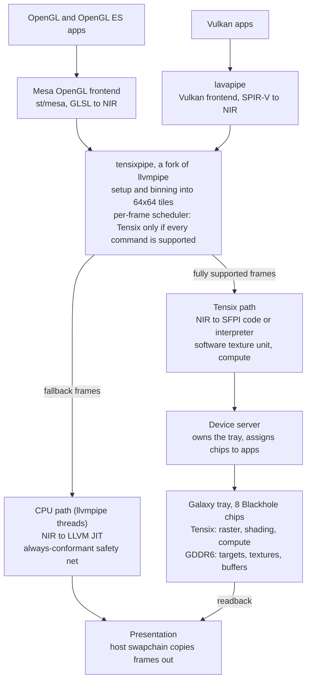

# Blackhole OpenGL + Vulkan: Full-Coverage Plan

_As of 2026-11-10 · Owner: Hyunggi Chang_

## How to use this plan (for Claude Code)

This plan sets the direction; the step-by-step work starts in the tt-raster plan (`docs/PLAN.md`), whose Phases 0 to 2 are P0 here.

- **Ask first:** before writing code or touching the hardware, read both plans, then send the user ONE message with all your clarifying questions, grouped and numbered, and wait for the answers. Check facts you can read off the machine yourself instead of asking.
- **Ask again when stuck:** whenever something is ambiguous or a decision is not covered here, stop and ask rather than guess.
- **Approved scope only:** do not start a phase or track the user has not approved; every gate in the roadmap is a check-in.

## Bottom line

Complete coverage means Khronos conformance for both APIs. The fastest credible route is one Mesa driver forked from llvmpipe and lavapipe: it passes the conformance tests on the CPU from day one, then moves work onto Tensix piece by piece.

- **Definition of done:** official Khronos conformance for Vulkan 1.3 (then 1.4), OpenGL 4.6 and OpenGL ES 3.2, proven with the Khronos Conformance Test Suite (CTS) and a formal submission.
- **Conformance needs correctness, not speed.** Mesa's CPU-only drivers are already conformant: [llvmpipe for OpenGL 4.5](https://www.phoronix.com/news/LLVMpipe-OpenGL-4.5-Conformant) and [lavapipe for Vulkan 1.3](https://www.phoronix.com/news/Lavapipe-Vulkan-1.3-Official).
- **Recommended strategy:** fork llvmpipe and lavapipe into one driver, working name tensixpipe. Both APIs already share that backend, so every stage moved to Tensix speeds up OpenGL and Vulkan at once.
- **Safety net:** a frame runs on Tensix only when every command in it is supported there, and on the CPU otherwise. The CTS therefore stays green at every commit.
- **Rough cost:** a passing build in months, because it inherits upstream correctness. Moving the common paths (rasterization, shading, textures, compute) onto Tensix takes a small team several years.
- **Honest ceiling:** Tensix has no texture units, so texture-heavy rendering stays far slower than a GPU. The meaningful bar is beating llvmpipe on the same host.

## Development hardware

The development machine is a Tenstorrent Galaxy server, and development uses only one of its trays: eight Blackhole chips. Every part of the driver must work on a single chip and across several chips of that tray.

- **Stay on the assigned tray:** never touch chips on the other trays, and ask before any reset, since a reset on a Galaxy can reach beyond one tray.
- **Single-chip mode:** one chip serves one driver instance. It is the default for debugging and for most test runs.
- **Throughput across chips:** the device server assigns chips to clients, so apps, CTS shards and RL environment processes run side by side, one or more per chip. A full CTS run shards across all eight chips.
- **One app across chips:** a frame's screen splits into one region per chip, each chip runs the tile renderer on its region, and the host assembles the frame. RL camera batches (MuJoCo, Isaac Lab) spread across chips with no chip-to-chip traffic.
- **Track W:** parallel MJWarp worlds spread across chips, and the policy can run on chips of its own.
- **To record first [VERIFY]:** which tray to use and how it is selected, the tray's chip topology (mesh shape and Ethernet links), how the host reaches each chip, and whether separate processes can hold separate chips at once. The device server design depends on the last point.

## What conformance demands that tt-raster lacks

Most of what conformance demands is missing from tt-raster today. Texture sampling, pointer-style memory access for compute, and fragment derivatives are the three hardest gaps; the rest is large but conventional work.

| Requirement | Needed by | Tensix gap | Approach |
| --- | --- | --- | --- |
| Texture sampling: filtering, mipmaps, wrap modes, cube, array and 3D textures | Both | No texture units; the SFPU cannot gather per-lane addresses | Software texture unit: data-movement cores fetch texels over the NoC into an L1 cache, the SFPU filters |
| Compressed formats (RGTC, BPTC, ETC2/EAC) | OpenGL 4.6 core; Vulkan apps expect at least one family | No decode hardware | Decode to uncompressed at upload |
| Fragment derivatives and implicit LOD | Both | Lanes are not arranged as 2x2 pixel quads | Quad-shaped lane mapping plus cross-lane moves [VERIFY], or analytic derivatives for plain interpolants |
| Compute shaders, shared memory, barriers, atomics | Vulkan (graphics requires a graphics-and-compute queue); OpenGL 4.3+ | No pointer-based memory access from the SFPU | Workgroup per core, invocation per lane, shared memory in L1, buffer access through the NoC with software caching |
| Raw buffer pointers and the Vulkan memory model | Vulkan 1.3 [VERIFY exact version] | Same as compute | NoC addresses as pointers; ordering through semaphores and barriers |
| 4x MSAA | Vulkan (sample counts 1 and 4); OpenGL 3.0+ | None today | Four samples per pixel as extra tile planes, Dest capacity permitting |
| Stencil, occlusion and timestamp queries | Both | None today | Stencil plane next to depth; per-core counters summed on the host |
| Geometry and tessellation shaders | OpenGL 4.6 (optional in Vulkan) | None today | CPU first; offload only if workloads need it |
| 64-bit float shaders | OpenGL 4.0+ (optional in Vulkan) | The SFPU is FP32 only | CPU first, then software double emulation |
| Transform feedback | OpenGL 3.0+; a Vulkan extension Zink relies on | None today | CPU first |
| Presentation | Both | No display output on the card | Host-side swapchain that copies finished frames into the window system |
| Several processes at once | Any real desktop | tt-metal opens the device exclusively [VERIFY] | A device server that owns the card and multiplexes clients |

## Strategy options

Option B wins: it passes the CTS on day one, and every Tensix gain lands in both APIs. Option C is where B can move later, once Linux on the X280 cores is mature.

| Option | How it works | When conformance arrives | Tensix use | Verdict |
| --- | --- | --- | --- | --- |
| A. Tensix-native | New Mesa Vulkan driver on the common runtime; OpenGL through Zink; everything executes on Tensix | Only after every required feature runs on Tensix, years in | Everything | Highest risk; nothing shippable for years |
| B. Conformant-first hybrid | Fork llvmpipe and lavapipe; add a Tensix backend under llvmpipe's tiled rasterizer and compute path; whole frames fall back to the CPU | From the first build, inherited from upstream | Grows phase by phase | Recommended |
| C. Card-resident | Run the Mesa stack on the X280 Linux tiles with Tensix as its accelerator; host apps reach it through a thin forwarding client | Same as B, once forwarding works | Same as B; fallback data never crosses PCIe | Later step for B |

Why llvmpipe is the right seam:

- Lavapipe is the Vulkan frontend built on llvmpipe, so one backend serves both APIs.
- llvmpipe already bins each frame into 64x64 screen tiles and shades them as independent tasks on worker threads. A 64x64 task is four Tensix tiles, so offload means replacing the task executor rather than redesigning the pipeline.
- Two separate drivers, one per API, would duplicate the hardest work, the shader compiler and the texture unit.

## Architecture

One driver serves both APIs: Mesa's OpenGL frontend and lavapipe sit unchanged on an llvmpipe fork, and only its execution backend learns to use Tensix.

Frames with any unsupported command take the CPU path, so conformance never depends on how much already runs on Tensix.

- Only the device server opens the tray's chips; every app's driver submits work to it.
- Presentation stays on the host: finished frames are read back and copied into the window system.
- OpenGL 4.6 can also come through Zink on top of the Vulkan side, the route Imagination ships as a [conformant product](https://www.collabora.com/news-and-blog/news-and-events/zink-on-imagination-gpus.html).

## Workstreams

Seven workstreams carry the project. The shader compiler and the software texture unit decide how much ever runs on Tensix; the rest decide whether it ships.

| Workstream | Core problem | Approach | First proof |
| --- | --- | --- | --- |
| 1. Shader compiler, NIR to Tensix | SIMT shaders on a 32-lane SFPU with predication; loops, calls, integer ops; GCC-based kernel JIT takes seconds | Lower NIR to SFPI code. A math-thread interpreter that issues precompiled SFPU sequences starts instantly while compiled variants build in the background [VERIFY issue rate]. Persistent shader cache | ALU-only CTS groups pass on the Tensix path |
| 2. Software texture unit | Gather, filtering, LOD, formats | Data-movement cores fetch texels over the NoC into an L1 cache of 32x32 texture tiles; the SFPU computes coordinates, weights and filtering; textures stored tiled in DRAM; compressed formats decoded at upload | Texture CTS groups pass on Tensix; vkcube renders on Tensix |
| 3. Resource residency | In a hybrid driver every resource lives on the host, a chip, or both | Per-resource validity and dirty tracking; migrate on demand; keep render targets on the chip between Tensix frames | Mixed CPU and Tensix frames produce identical images |
| 4. Compute and memory model | Pointers, shared memory, atomics, barriers | Workgroup per core, invocation per lane, shared memory in L1, buffers through the NoC with a software cache flushed at barriers; atomics through NoC atomics [VERIFY] or an owner core per address range | Compute CTS groups pass on Tensix |
| 5. Fixed function in software | MSAA, blend formats, stencil, queries, line and point rules | Extend the tt-raster SFPU kernels; rare features stay on the CPU path | Fragment-operation CTS groups pass on Tensix |
| 6. Device server and runtime | Several processes, scheduling, hang recovery, sync objects | A daemon owns the tray's chips through tt-metal and assigns chips to clients; clients submit command streams through shared memory; a watchdog resets chips and fails or replays contexts | Two apps render at once on different chips; a forced hang recovers |
| 7. Conformance engineering | Full CTS runs take many hours on software drivers | Shard the CTS across the tray's eight chips and across machines; nightly full runs, per-commit subsets; track the share of tests whose frames ran on Tensix | Nightly dashboard with pass counts per path |

## Roadmap

Conformance comes first and never regresses; each later phase moves one class of work onto Tensix and ends at a gate. Durations are rough estimates for the team in Team and effort, about three years in total.

| Phase | Rough duration | Scope | Gate at the end |
| --- | --- | --- | --- |
| P0 + P1, in parallel: foundation and conformant base | About 4 months | tt-raster phases 0 to 2 on Tensix; llvmpipe and lavapipe fork, device server, CTS farm | CTS results match upstream llvmpipe and lavapipe |
| P2 First offload | About 6 months | Untextured rasterization and ALU-only shaders run on Tensix for whole frames | **Kill gate:** a target workload beats llvmpipe on the same host, or offload work stops |
| P3 Software texture unit | About 9 months | Texel fetch over the NoC into an L1 cache, filtering on the SFPU, decode at upload | **Kill gate:** texture CTS groups pass on Tensix, and textured frames are worth offloading |
| P4 Compute on Tensix | About 6 months | Buffers through the NoC, shared memory in L1, barriers and atomics | Compute CTS groups pass on the Tensix path |
| P5 Coverage push | About 9 months | MSAA, stencil, queries, fp64 emulation; geometry and tessellation only if workloads need them | An agreed share of CTS frames executes on Tensix |
| P6 Conformance submissions | About 3 months | Vulkan 1.3 then 1.4, OpenGL 4.6 and OpenGL ES 3.2 | Khronos accepts the submissions |
| Later: card-resident driver | Not estimated | Move the Mesa stack onto the X280 cores so fallback data never leaves the card | None yet |

- P0 reuses Phases 0 to 2 of the tt-raster plan (`docs/PLAN.md`). Its Track G (the softpipe fork) is superseded by P1 and P2 here.
- A submission is possible any time after the first gate, since the CPU path already passes. It carries weight once most frames run on Tensix.

## Workload targets

Each phase gets a real application as its visible demo. Godot is the main test vehicle because one engine exercises both APIs; MuJoCo is the robotics target, with MuJoCo Warp in Track W as the end goal.

| Phase | Workload | API | Why it fits here |
| --- | --- | --- | --- |
| P2 | glxgears, untextured demos, MuJoCo depth and segmentation | OpenGL, Vulkan | Rasterization and ALU shaders only; MuJoCo scenes are mostly flat-colored primitives |
| P3 | Godot 2D (Compatibility renderer), MuJoCo with textures and shadows | OpenGL 3.3, OpenGL 1.5 | Coherent sprite texturing suits the L1 texture-tile cache; MuJoCo adds checker floors, skyboxes and shadow maps |
| P4 | Godot 3D (Mobile renderer), MuJoCo Filament with effects off | Vulkan; OpenGL or Vulkan | The Mobile renderer avoids heavy compute; Filament runs on either API |
| P5 | Godot Forward+, MuJoCo Filament with default effects | Vulkan; OpenGL or Vulkan | Compute effects and post-processing, including Filament's default SSAO |

- **Godot requirements:** the Compatibility renderer needs OpenGL 3.3; Forward+ and Mobile need Vulkan 1.0 ([Godot docs](https://docs.godotengine.org/en/latest/about/system_requirements.html)).
- **Godot as a test harness:** it is open source, so engine-side bugs can be debugged too. Its demo projects form a regression suite, and Movie Maker mode (`--write-movie`) renders deterministic frames to diff against llvmpipe.
- **MuJoCo renderers:** the classic renderer uses OpenGL 1.5 in the compatibility profile plus two extensions and is in maintenance mode. The Filament renderer, recommended for new applications, runs on OpenGL or Vulkan ([MuJoCo docs](https://mujoco.readthedocs.io/en/latest/programming/rendering.html)).
- **MuJoCo without a GPU:** physics runs on the host CPU, so CPU physics plus Blackhole rendering needs no NVIDIA GPU at all.
- **MuJoCo hookup:** use `MUJOCO_GL=egl`, because Mesa dropped OSMesa as redundant with EGL surfaceless ([Mesa MR 33836](https://gitlab.freedesktop.org/mesa/mesa/-/merge_requests/33836)). Confirm that MuJoCo's EGL backend picks Mesa's software EGL device [VERIFY]. Parallel RL environments mean many processes, so the device server (Workstream 6) comes first and spreads them across the tray's chips. A third-party Filament renderer, [mujofil](https://pypi.org/project/mujofil/), documents headless runs on software Vulkan such as lavapipe.
- **Not targeted: League of Legends.** Its kernel-level anti-cheat rejects Linux and Wine, whatever the driver ([GamingOnLinux](https://www.gamingonlinux.com/2024/04/riot-games-talk-vanguard-anti-cheat-for-league-of-legends-and-why-its-a-no-for-linux/page=1/)).
- **Windows DirectX games** without kernel anti-cheat can run through Proton and DXVK. DXVK needs Vulkan 1.3 plus VK_EXT_robustness2 and VK_KHR_maintenance5 ([DXVK wiki](https://github.com/doitsujin/dxvk/wiki/Driver-support)), and these games need BC1 to BC7 texture decode.

## Track W: MuJoCo Warp

Track W is the end goal: MuJoCo Warp's physics and batch renderer running on Tensix, so physics, cameras and the policy share one Galaxy tray with no NVIDIA GPU. It is a compute port, not a graphics-API problem, and it starts once P4 has proven the compute path.

**Why it matters**

- MJWarp is maintained by Google DeepMind and NVIDIA as part of Newton. Isaac Lab reaches it through Newton, JAX users through MJX, and PyTorch users through mjlab ([GitHub](https://github.com/google-deepmind/mujoco_warp)).
- Its batch renderer ray-traces cameras across many parallel worlds and supports meshes, textures, heightfields and Gaussian splats, which ties in with tt-raster's 3DGS track.
- Today it needs an NVIDIA GPU for speed; its CPU path is for development and debugging only ([PyPI](https://pypi.org/project/mujoco-warp/3.9.0/)).

**W.1 Scoping spike: MJX on tt-xla**

- Run MJX's pure-JAX implementation through Tenstorrent's JAX stack (tt-xla) on a few models, and record which operations fail or fall back: gather and scatter, while loops, dynamic indexing. [VERIFY that the pure-JAX implementation is still maintained next to the Warp backend]
- DoD: an operation coverage report and a go or no-go for W.2.

**W.2 Warp backend for Tensix**

- Add a third Warp code-generation target next to CPU and CUDA that emits tt-metal kernels. SIMT threads become SFPU lanes with predication (reuses Workstream 1); array access and atomics go through the NoC (reuses Workstream 4).
- Map Warp tile operations such as matrix multiply and Cholesky onto the Tensix matrix engine wherever MJWarp uses them [VERIFY which kernels do].
- DoD: Warp's unit tests pass on the Tensix device for an agreed subset of kernel features.

**W.3 MJWarp physics bring-up**

- Start with simple models (pendulum, cartpole), then a humanoid, and compare trajectories against CPU MuJoCo within a tolerance.
- Expect the irregular stages, broadphase and narrowphase collision and constraint assembly with scatter-add, to be the hotspots.
- DoD: MJWarp's tests pass for the chosen models, and PERF.md compares steps per second with the CPU path.

**W.4 Batch renderer and full stack**

- Run MJWarp's ray-traced batch renderer on Tensix, then train a vision policy end to end on the tray, with worlds spread across chips: physics, cameras and policy.
- DoD: one vision task from MuJoCo Playground or mjlab trains on Blackhole alone.

**Effort:** outside the Team and effort estimate. It adds at least one compiler engineer who knows Warp's code generation.

## Team and effort

Rough, unvalidated estimate: six to seven engineers for about three years to run most CTS frames on Tensix, with a passing CPU-backed build within about four months.

| Role | Headcount | Owns |
| --- | --- | --- |
| Mesa driver engineer | 2 | llvmpipe and lavapipe fork, fallback scheduler, residency, presentation |
| Shader compiler engineer | 1 to 2 | NIR to Tensix, interpreter, shader cache |
| Tensix kernel engineer | 2 | Raster, texture unit, compute and fixed-function kernels |
| Runtime and CI engineer | 1 | Device server, CTS farm, dashboards |

- Phases end when their CTS groups pass on the Tensix path, not on calendar dates.
- Agentic coding fits unusually well here: the CTS is a very large set of objective pass or fail results. Claude Code can grind through test groups while engineers own architecture and Tensix performance.

## Risks and kill criteria

The real risk is not failing conformance, which the CPU path guarantees, but offload that never beats llvmpipe; two explicit kill criteria guard against that.

| Risk | Early signal | Response |
| --- | --- | --- |
| Offload slower than llvmpipe on the same host (PCIe copies, launch overhead) | Phase 2 benchmarks | Keep data on the chip, submit whole frames, batch launches |
| Software texturing too slow to matter | Phase 3 texel-rate numbers | Keep textured frames on the CPU; raise texture units as a silicon request |
| Shader compile stalls | Pipeline-creation times in real apps | Interpreter path plus persistent cache |
| tt-metal allows one process per device | Phase 1 device-server spike | Device server; ask the tt-metal team about multi-process support |
| Fork drifts from upstream Mesa | Rebase conflicts | Rebase monthly; propose the backend interface upstream early |
| Submission logistics | Before the first submission | llvmpipe was certified under the SPI/X.Org umbrella; confirm whether a Tenstorrent-hosted fork can use the same route [VERIFY] |
| Device hangs under complex kernels | Watcher incidents in CTS runs | Watchdog and reset in the device server; CTS sharding that tolerates crashes |

**Kill criteria**

- End of Phase 2: if no target workload runs faster than llvmpipe on the same host, stop offload work. Ship the conformant driver with Tensix demos.
- End of Phase 3: if textured frames stay far slower than llvmpipe, keep texturing on the CPU and continue only with untextured and compute paths.

## Sources

- [Phoronix: LLVMpipe is now officially conformant with OpenGL 4.5](https://www.phoronix.com/news/LLVMpipe-OpenGL-4.5-Conformant) (30 October 2020): Khronos-recognized OpenGL 4.5 implementation, submitted under the SPI/X.Org umbrella.
- [Phoronix: Lavapipe now compliant with Vulkan 1.3](https://www.phoronix.com/news/Lavapipe-Vulkan-1.3-Official) (20 July 2022): Khronos-recognized Vulkan 1.3 implementation running on a desktop CPU.
- [Collabora: Zink brings conformant OpenGL on Imagination GPUs](https://www.collabora.com/news-and-blog/news-and-events/zink-on-imagination-gpus.html) (6 July 2023): the first shipping product with conformant OpenGL 4.6 layered on Vulkan.
- [Godot docs: System requirements](https://docs.godotengine.org/en/latest/about/system_requirements.html): the Compatibility renderer needs OpenGL 3.3; Forward+ and Mobile need Vulkan 1.0.
- [MuJoCo docs: Rendering](https://mujoco.readthedocs.io/en/latest/programming/rendering.html): the classic renderer uses OpenGL 1.5 in the compatibility profile and is in maintenance mode; the Filament renderer supports OpenGL and Vulkan.
- [Mesa merge request 33836](https://gitlab.freedesktop.org/mesa/mesa/-/merge_requests/33836): removes OSMesa as redundant with EGL surfaceless.
- [mujofil on PyPI](https://pypi.org/project/mujofil/): third-party Filament renderer for MuJoCo; software Vulkan such as lavapipe works for headless CI.
- [MuJoCo Warp on GitHub](https://github.com/google-deepmind/mujoco_warp): designed for NVIDIA hardware; ray-traced batch renderer with mesh, texture and Gaussian splat support; Isaac Lab integrates it through Newton.
- [mujoco-warp on PyPI](https://pypi.org/project/mujoco-warp/3.9.0/): NVIDIA GPU for fast simulation, CPU for development and debugging; maintained by Google DeepMind and NVIDIA as part of Newton.
- [GamingOnLinux: Riot on Vanguard for League of Legends and Linux](https://www.gamingonlinux.com/2024/04/riot-games-talk-vanguard-anti-cheat-for-league-of-legends-and-why-its-a-no-for-linux/page=1/) (April 2024): Wine cannot satisfy Vanguard's driver requirements.
- [DXVK wiki: Driver support](https://github.com/doitsujin/dxvk/wiki/Driver-support): Vulkan 1.3 plus the required extensions.
