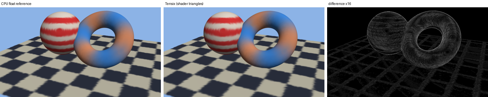

# 3D Gaussian Splatting on tt-raster (Track S)

`plugins/gaussian` renders 3D Gaussian Splatting scenes (Kerbl et al., SIGGRAPH 2023) on top of the renderer core. It is a plugin: it uses the core's public pieces (the frame description, the backends) and nothing of OpenGL, Vulkan or Isaac Lab, so someone who wants only the renderer does not build or load it. Layout: `src/gs/` (scene, projection, PLY, renderers), `src/capi/` and `include/ttraster/ttraster_gs.h` (`libttraster_gaussian.so`), `python/ttraster_gs/`, `tools/ttr_gsplat.cpp`, `tests/`.

*A synthetic scene of 200,000 flat Gaussians (floor, sphere, torus), 960 x 540. Left: the float CPU reference. Middle: the same splats drawn on a chip. Right: the absolute difference, multiplied by 16 (PSNR 46.9 dB, at most 15 levels).*

## What is implemented

**Scene and camera** (`gs/gaussians.h`). A scene is what a trained model is: positions, linear scales, unit quaternions, opacities in [0, 1] and spherical-harmonics colour up to degree 3. Conventions are the repository's: pixel centres at +0.5, y down; the camera matrix is world to camera, row-major, z forward. `GaussianScene::validate` refuses non-finite values, non-positive scales, non-unit quaternions and opacities outside [0, 1].

**Projection** (`gs/project.cpp`, `project()`), the reference implementation's preprocessing: the 3D covariance `R S S^T R^T`, the EWA Jacobian at the Gaussian's centre (the view direction clamped to 1.3 times the field of view), `cov2 = (J W) cov3 (J W)^T` plus 0.3 on the diagonal, the conic (the inverse of cov2), the spherical-harmonics colour for the view direction (+ 0.5, at least 0), culling (closer than `znear` = 0.2, opacity below 1/255, degenerate covariance, off screen). The footprint is not the original's 3-sigma circle: a splat can only reach alpha 1/255 inside the ellipse at a Mahalanobis distance of `sqrt(2 ln(255 opacity))` (3.3 sigma for opacity 1), so the splat carries the half side of the square that contains exactly that, plus one pixel. The result then does not depend on how the renderer tiles the screen. The output is in scene order whatever the thread count.

**Reference renderer** (`render_reference`): float, on the CPU thread pool, 32 x 32 tiles (the original uses 16 x 16; this changes speed only), per-tile lists in depth order (ties by scene index), per pixel the original's rule: `alpha = min(0.99, opacity exp(power))`, a splat with alpha below 1/255 is skipped, the pixel is finished when its transmittance would fall below 1e-4, the background is added with what is left. It differs from the original CUDA rasterizer only where the original culls to the tiles touched by a 3-sigma circle and this one applies a splat wherever its alpha is at least 1/255 (a ring between 3 and 3.3 sigma with alpha at most 0.011).

**Renderer through the core's backends** (`render_backend`): every splat becomes a square of two triangles with a 20-instruction fragment shader (`splat_shader()`: the Gaussian's exponent from the conic and the pixel centre, `exp` through `Ex2`, alpha, two `Kill`s for `power > 0` and `alpha < 1/255`), the Gaussian's parameters passed as constant varyings, the over operator as the triangle's blend state, depth test off, triangles in API order from the farthest splat to the nearest. Back to front with the over operator sums the same terms as the front-to-back recursion. It runs on any backend: the core's CPU rasterizer, a chip (also several; also through the device server) with the interpreter or with compiled shaders. Nothing in the core changed for it.

**Data**: `read_ply` / `write_ply` for the PLY of the reference implementation (binary little endian; opacity as logit, scale as log, rotation not normalised, `f_rest` channel-major; any property order and scalar type, unknown properties skipped; degree from the number of `f_rest` properties), `make_synthetic_scene` (blobs and a disc, random orientations, view-dependent terms) and `make_demo_scene` (floor, sphere, torus with flat Gaussians along the normals). No trained model is in the repository, none was downloaded (the plan asks the user to choose one); the PLY reader is tested by round trips and malformed files. **The C API** is `include/ttraster/ttraster_gs.h`; the Python package is `ttraster_gs` (`Scene`, `Camera`, `Renderer`; numpy in, numpy out).

## Tests

`plugins/gaussian/tests/test_gaussian.cpp` (in `ctest`): the camera conventions; the SH basis is orthonormal (numerical quadrature of all 16 functions over the sphere, deviation under 2e-3) and has the reference implementation's sign convention; **the projected covariance against a Monte-Carlo estimate** (400,000 samples of an anisotropic rotated Gaussian, exact perspective projection of each, within 4 %); the footprint radius; culling counts; thread-count independence of `project`; PLY round trips for degrees 0 to 3 (at most 1e-5 off) and refusal of a non-PLY, an ASCII file, a missing property and a truncated file; the renderer against closed forms (the pixel values of a single Gaussian to 2e-6, the nearer of two Gaussians wins and swapping the depths swaps the result, nothing shows behind opaque layers); and the backend path against the float reference on a 20,000-Gaussian scene (PSNR 50.4 dB). `plugins/gaussian/tests/test_gaussian.py` repeats the end-to-end checks through the Python binding (`--backend tensix` on a chip). `scripts/test_python.sh` runs it.

## Measured

Accuracy of the backend path against the float reference (8-bit images, PSNR over RGB; the demo scene at 1280 x 720, chip with compiled shaders):

| Gaussians | splats on screen | PSNR | largest error |
| --- | --- | --- | --- |
| 50,000 | 47,000 | 51.0 dB | 8 levels |
| 200,000 | 190,000 | 47.0 dB | 13 levels |
| 800,000 | 759,000 | 41.4 dB | 28 levels |

On the 20,000-Gaussian test scene the chip and the core's CPU backend give the same PSNR (50.88 dB, `test_gaussian.py`); the error is the 8-bit target, not the device. A frame with shaders quantizes every blend to 8 bits, so a splat whose contribution is under half a level (alpha below 0.5/255 times the colour difference) vanishes, and many faint splats lose their sum: the error grows with the number of splats on a pixel, as in the table. Trained scenes have millions of Gaussians with a lot of overdraw and many faint ones, so there this path is expected to be below the 40 dB the plan asks for. Float accumulation needs a kernel with float colour and transmittance planes in Dest, which the core does not have.

Time per frame, 1280 x 720, demo scene, node 5 (x8 link), median of 3 after a warm-up (a shader build of about 9 s the first time, cached afterwards, or pre-warmed: `docs/EVALUATION_GL_VULKAN.md`). "CPU" is the float reference on this host's 64 threads (projection 9 to 33 ms is not included in either column; it is the same on both).

| Gaussians | CPU, float reference (bin + raster) | chip, interpreter | chip, compiled shader: frame (device) | 8 chips, compiled: frame (device) |
| --- | --- | --- | --- | --- |
| 50,000 | 70 ms (7 + 63) | not run | 94 ms (52) | not run |
| 200,000 | 148 ms (33 + 115) | not run | 353 ms (200) | 242 ms (111) |
| 800,000 | 600 ms (195 + 404) | not run | 1,419 ms (821) | 985 ms (439) |

(For 100,000 synthetic Gaussians: CPU 97 ms, one chip 849 ms with the interpreter and 471 ms compiled, eight chips 313 ms.) At 1920 x 1080 and 200,000 Gaussians the CPU reference takes 209 ms.

**The chip loses to the 64-thread CPU on this workload, by 1.5 to 3.5 times, and its images are less exact.** What costs time, from the numbers: the device time is about 14 microseconds of one core per (triangle, tile) record (200 ms on 120 cores for 1.67 million records), against 3.5 microseconds for a fixed-function record of the core; the 20 instructions and the blend are most of it. A Gaussian scene is the opposite of the workload this renderer is good at: all the work is per-pixel arithmetic over long per-tile lists, and one core must run a tile's whole list (at 800,000 Gaussians the densest tile has several thousand records), so eight chips give only 1.6 to 1.9 times one chip. The SFPU issues about 13 ns per instruction and pixel vector, against 64 CPU threads of eight-lane SIMD with an early exit per pixel. Beyond that the host side of a frame is large (building the frame 260 ms and encoding 183 ms at 800,000 Gaussians, about the cost of the CPU render itself).

What would help, and was not built: a dedicated kernel with float colour and transmittance planes in Dest (exactness, and no blend and quantization per splat: perhaps 2 times faster per record), one record per Gaussian and tile instead of two triangles (half the records at the diagonal), splitting a dense tile between cores by pixel rows, and projection and spherical harmonics on the device (stage S.4 of the plan: the host stages here are about a quarter of the chip frame). None of them would take the chip clearly past the CPU on this host, so the CPU reference renderer is the useful product of this track; the Tensix path is kept as a working, tested and measured second backend (and as the way to run Gaussian scenes through a device server or several chips). The gate in `docs/FULL_COVERAGE_PLAN.md` for texturing (stop if the chip is far slower than the CPU) applies in spirit here, and 4D Gaussians (time-varying) would add only a per-frame projection step in front of the same renderers.

## Not done

Real scenes (no `.ply` was supplied and nothing was downloaded; the reader follows the layout of the reference implementation's `point_cloud.ply` and is tested only on files written by `write_ply`); targets above 2048 x 2048 on the backend path (the core's limit; the float reference has none); a comparison against gsplat or the CUDA rasterizer's images (optional in the plan: the reference here follows the same equations, tested piece by piece above); 4D Gaussians; camera paths and video.
