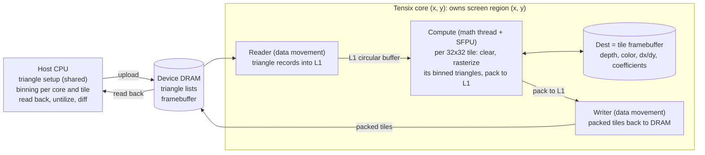

# tt-raster: Tensix Software Rasterizer — Action Plan for Claude Code

_As of 2026-11-10 · Owner: Hyunggi Chang_

## How to use this plan

**Before any work: ask first.** This plan is your prompt. Before writing code or touching the hardware, read the whole plan, then send the user ONE message with every clarifying question you have, grouped and numbered, and wait for the answers. Ask only what you cannot find out yourself; facts you can read off the machine (tt-smi, the tt-metal checkout, installed packages) you check instead. During the work, whenever something is ambiguous or a decision is not covered here, stop and ask rather than guess.

Questions to include at the start, unless the user already answered them:

1. Which Galaxy tray to use, and how it is selected (chip ids or a device-visibility setting).
2. Whether other people use the server's other trays, and whether a chip reset can affect them.
3. Where tt-metal is installed, which commit to pin, and whether to build a fresh checkout.
4. Where this repository lives, and whether to push to a remote.
5. Anything in this plan that conflicts with what you find on the machine.

Work phase by phase, and stop at every STOP gate for review before starting the next phase.

- **Critical path:** Phases 0, 1, 2 in order. After Phase 2 the user picks Track G (OpenGL through Mesa), Track S (3D Gaussian Splatting) or Track I (Isaac Lab renderer backend). Phase P (multicast and performance) can follow any track.
- **Definition of Done:** each phase lists tasks and a DoD. A phase is done only when its DoD holds and its tests pass.
- **[VERIFY] items** are unconfirmed hardware or API assumptions. Confirm or refute each before building on it, and record the answer with its evidence (doc link, source path or measurement) in `docs/FINDINGS.md`.
- **The installed code wins.** tt-metal and Isaac Lab APIs change quickly. Prefer the idioms in the installed version's examples over any API name in this plan, and log mismatches in FINDINGS.md.
- **Measurements** go into `docs/PERF.md` as rows: what was measured, configuration, result with units, commit.
- **At each STOP:** summarize what was built, what was verified, open problems and the recommended next step, then wait.
- **Timebox:** if blocked after about three materially different attempts, stop and report.
- **Ask first** before installing system packages, changing firmware or global environment, downloading more than 1 GB, or editing tt-metal core sources.
- **Device etiquette on the Galaxy:** use only the assigned tray, and never run two device programs on the same chip at once. Routine tests use one chip; multi-chip tests take only the chips they need. After a hang, save watcher and DPRINT output, ask the user before any reset (a reset on a Galaxy can reach beyond one tray), and log the incident.

Decisions reserved for the user:

| Gate | Decision |
| --- | --- |
| Before Phase 0 | Answers to Claude Code's clarifying questions, including which tray to use |
| End of Phase 0 | Scalar-delivery approach and Dest tile layout |
| End of Phase 2 | Track G, Track S or Track I first |
| Start of Track S | Which pretrained 3DGS scene (.ply path) to use |
| Start of Track I | Isaac Lab version, and which NVIDIA GPU runs physics |

Kickoff message for a fresh Claude Code session: `Read docs/PLAN.md, send me your clarifying questions first, then do Phase 0 and stop at its STOP gate.`

## Goal, scope and non-goals

Build a tile-based software rasterizer on Blackhole Tensix cores, prove it pixel-accurate against a CPU reference, then put a standard API or a real workload on top.

**In scope**

- Hardware: the development machine is a Tenstorrent Galaxy server. Development uses only one of its trays, eight Blackhole chips; never touch chips on other trays. Everything must run on a single chip and on several chips of that tray, selected at runtime. Query the real worker grid size and chip list; never hard-code a core or chip count.
- Untextured triangles: depth test, flat and smooth (Gouraud) color, later optional alpha blending.
- Track G: a Mesa Gallium driver that runs untextured OpenGL programs such as glxgears.
- Track S: a 3D Gaussian Splatting renderer, which needs no texture sampling at all.
- Track I: a camera renderer backend for Isaac Lab 3.x that produces policy observations (depth, segmentation, normals, albedo, direct-lit RGB).

**Out of scope**

- Vulkan conformance, MSAA, stencil, geometry and tessellation shaders. Texture sampling only as a late experiment.
- Running Isaac Sim itself: its RTX renderer requires an NVIDIA GPU with RT cores. Track I targets Isaac Lab's pluggable renderer instead.
- Beating a GPU. Success means correct images plus an honest performance breakdown.
- Display output from the hardware. Frames come back to the host.
- Upstreaming anything to Mesa, tt-metal or Isaac Lab.

## Architecture

Each worker core owns one rectangle of the screen, so depth tests and blending need no cross-core synchronization. While a 32x32 tile is being shaded, Dest is its on-chip framebuffer.



The host sets up and bins the frame. On each core a reader streams triangle records into L1, the compute kernel rasterizes each tile inside Dest, and a writer returns packed tiles.

- The frame is deferred: every triangle is binned before rendering, so each tile is shaded exactly once, as on tile-based mobile GPUs and Larrabee.
- Edge functions, depth and color planes are evaluated per lane in tile-relative coordinates, and coverage is a `v_if` lane mask.
- Phase P swaps per-core DRAM lists for NoC multicast, because a triangle's screen bounding box maps to a rectangle of cores.
- Track I changes the split: cameras are small, so each core renders whole camera images instead of a screen region.
- Multi-chip: the screen first splits into one region per chip, and each chip runs the same tile renderer on its region; the host assembles the frame. Single-chip mode is the same code with one region. Camera batches (Track I) and Gaussian tiles (Track S) spread across chips the same way.

## Assumptions to verify first

Every item below shapes the kernel design, so Phase 0 confirms or refutes each one and records the evidence in FINDINGS.md.

| ID | Assumption [VERIFY] | Why it matters | How to check |
| --- | --- | --- | --- |
| V1 | The SFPU is a 32-lane FP32 SIMD unit that loads and stores 32 values at a time between Dest and its local registers. The lane-to-(row, col) mapping inside a 16x16 face is unknown. | Gives each lane its pixel coordinate | Blackhole ISA docs (vector unit), existing SFPU kernels' `dst_reg` loops, Spike A |
| V2 | Dest holds a fixed number of 32x32 tiles, fewer in FP32 mode and fewer again with half-sync double buffering. | How many framebuffer and helper tiles stay resident | tt-metal docs on the Dst register, ComputeConfig options, Spike C |
| V3 | One SFPU function can read and write several Dest tiles at fixed offsets, as binary and ternary SFPU ops do. | Depth, color and coordinates in a single pass | Search tt-llk for multi-tile SFPU ops and the per-tile `dst_reg` offset |
| V4 | A compute kernel can keep tiles in Dest across a long loop: acquire, many SFPU passes, then commit. | Lets Dest act as on-chip tile memory | Spikes B and C |
| V5 | Runtime scalars can reach SFPU registers through (A) the math thread reading L1 and issuing runtime-immediate loads, (B) a coefficient tile with each value replicated across lanes, unpacked into Dest, or (C) programmable SFPU constant registers. | Per-triangle coefficients are the main per-triangle cost | Unary SFPU ops that take a runtime scalar show path A; Spike B measures all three |
| V6 | The SFPU issues about one vector instruction per cycle, multiply-add included. | Sets the cycle budget per triangle and tile | Device profiler on a multiply-add loop; AI clock from tt-smi |
| V7 | Blackhole baby RISC-V cores may cache L1 reads, so polling a word written by another core needs an invalidate. | Correct custom handshakes between kernels | Read how tt-metal implements semaphore waits on Blackhole |
| V8 | The SFPU cannot gather per-lane addresses from L1. | Documents why texturing is out of scope | ISA docs |
| V9 | Blackhole has alignment rules for NoC reads and writes to DRAM and L1. | Triangle record padding and buffer layout | tt-metal docs and HAL constants |
| V10 | SFPU math differs from IEEE FP32 in rounding, denormals or compares. | Decides bit-exact vs tolerance tests | Spike A and B comparisons with the CPU |

## Repository layout and conventions

Start inside the tt-metal tree as a new programming example, since that build path already works; move out of tree only if it gets in the way.

```text
tt-raster/
  docs/              PLAN.md, FINDINGS.md, PERF.md
  host/              scene I/O, triangle setup, binning, device runtime
  kernels/
    dataflow/        reader_*.cpp, writer_*.cpp
    compute/         raster_*.cpp, sfpu/*.h
  ref/               CPU reference rasterizer (3DGS reference later)
  tests/             scenes, small golden images, runner script
  tools/             image diff, PNG/PPM conversion
  capi/              libttraster C ABI (Tracks G and I)
  isaaclab_ttraster/ Isaac Lab renderer shim (Track I)
```

**Conventions**

- Triangle setup and binning live in one module used by both the CPU reference and the device path, so the two differ only in rasterization.
- Fixed seeds everywhere. Golden images up to 256x256 are committed; larger ones are regenerated on demand.
- One test script runs CPU and device tests and prints pass or fail per scene with mismatch count and PSNR.
- The test script runs every device test in single-chip mode and in multi-chip mode (all eight chips); multi-chip output must match single-chip output exactly.
- Commit at every DoD with the phase in the message.
- Kernel source paths in CreateKernel may resolve relative to the tt-metal root; copy how the example you start from does it.
- English for code, comments and docs.

**Debug toolbox**

- Watcher (`TT_METAL_WATCHER`) for hangs and NoC address checks.
- DPRINT from kernels (`TT_METAL_DPRINT_CORES`), used sparingly because it perturbs timing.
- Device profiler zones inside kernels for cycle counts. Check whether the build needs profiling enabled.
- tt-smi for card status, AI clock and reset.
- Host timers around enqueue and finish for end-to-end frame time.

## Phase 0: environment and hardware spikes

Phase 0 retires the riskiest unknowns with five small spikes before any renderer code exists.

**0.1 Environment**

- Record firmware, AI clock (tt-smi), tt-metal commit and the worker grid size the device API reports, in FINDINGS.md.
- The machine is a Galaxy server, and development uses one tray of eight Blackhole chips. Confirm the assigned tray with the user, then record its chip ids, the mesh shape and Ethernet links between chips, how the host reaches each chip, and whether separate processes can hold separate chips at once [VERIFY].
- Build and run one stock programming example end to end, plus one SFPU example such as the eltwise SFPU one.

**0.2 Required reading** (summarize the facts, with links, in FINDINGS.md)

- `METALIUM_GUIDE.md` and the docs' Advanced Topics: tiles, memory from a kernel developer's view, compute engines and data flow (Dst register, SFPU), FP32 accuracy.
- Blackhole ISA documentation, vector unit sections.
- SFPI programming material (`vFloat`, `v_if`, `dst_reg`) and a handful of SFPU kernels in tt-llk.
- The multicast matmul programming example: sender and receiver kernels, semaphores.

**0.3 Spike A: lane map and tile layout**

- Host builds dx and dy coordinate tiles (0 to 31) in row-major order, tilizes them with tt-metal's host utilities and uploads them.
- Compute kernel unpacks them into Dest; the SFPU writes f(dx, dy), a checkerboard plus a gradient; the result is packed back.
- DoD: the untilized output equals the CPU result exactly, and the lane mapping is written in FINDINGS.md.

**0.4 Spike B: runtime scalars into the SFPU (the crux)**

- Keep N FP32 tiles in Dest and loop K times. Each iteration takes M runtime scalars and does a masked update such as `v_if (a*dx + b*dy + c >= 0) { acc += d; }`.
- Implement approaches A, B and C from V5 and check each against the CPU.
- DoD: a PERF.md table of cycles per scalar load and per iteration for each approach, plus a recommendation.

**0.5 Spike C: Dest capacity and residency**

- Find the most FP32 tiles that can stay resident in each sync mode, and confirm long acquire-to-commit loops are safe.
- DoD: the numbers, plus the Dest layout for Phase 2 (which tile slot holds depth, color, coordinates and coefficients).

**0.6 Spike D: multicast**

- One sender core multicasts a 4 KB buffer to a rectangle of cores with a semaphore handshake; receivers checksum it.
- Try several rectangles, including grid edges and the full grid. Use the device's logical-to-NoC coordinate translation and watch for non-Tensix columns and harvested cores.
- DoD: correct on every rectangle; latency and bandwidth in PERF.md.

**0.7 Spike E: single chip and full tray**

- Open one chip, then all eight chips as a mesh with the installed tt-metal mesh API, and run a trivial program in both modes from the same binary, chosen by a runtime option.
- Measure host-to-chip and chip-to-chip bandwidth over the tray's links.
- DoD: both modes work, and the numbers are in PERF.md.

**STOP:** report the status of V1 to V10, the Spike B numbers, the recommended scalar path and Dest layout, and the tray topology.

## Phase 1: CPU reference rasterizer and test infrastructure

Phase 1 builds the golden reference and the harness, so every later device result is checked pixel by pixel.

**1.1 Frame format**

- C++ structs for a frame: viewport padded up to a multiple of 32 on both axes, clear color and depth, and a list of screen-space triangles.
- Each vertex carries x and y in pixels, z in [0, 1], 1/w and RGBA. Depth test LESS or LEQUAL; opaque first, alpha blending later.

**1.2 Triangle setup (the shared module)**

- Snap vertices to 4 subpixel bits (1/16 px). Build three edge functions with a top-left fill rule, reject degenerate triangles, optionally cull back faces.
- Compute the bounding box in 32x32 tiles, and plane equations for depth and each color channel, evaluated relative to each tile's origin.
- Bound magnitudes so a·dx and b·dy are exact in FP32. With 4 subpixel bits, 32-pixel tiles and screens up to 2048 px, both stay below 2^24.
- Adding the tile-origin term can still round for very large triangles. The watertightness test decides whether an exact int32 path is needed (see Risks).
- Flat shading uses the provoking vertex. Smooth color is screen-linear in v1; perspective-correct interpolation with 1/w arrives in Track G.

**1.3 CPU reference**

- Rasterize from the same setup output with the same tile-relative FP32 evaluation order the device will use, so any difference points at the device.
- Keep an exact int64 edge-function rasterizer as a coverage oracle; snapped coordinates make the edge functions integers.

**1.4 Test scenes** (procedural and deterministic)

- One triangle; a shared-edge fan and grid mesh; interpenetrating triangles; one screen-covering triangle; 10,000 tiny triangles; 10,000 random triangles.
- Watertightness check: inside the shared-edge mesh every pixel is covered exactly once.

**1.5 Image tools**

- PNG or PPM writer, and a diff tool that reports mismatched pixels, max absolute error and PSNR and writes a heatmap.

**DoD:** the CPU reference passes the watertightness check at 1920x1088 against the int64 oracle, and golden images exist for every scene.

**STOP.**

## Phase 2: Tensix rasterizer v1

Phase 2 renders the Phase 1 scenes on Tensix, first one 32x32 tile on one core, then the whole screen across the grid.

**2.1 One core, one tile**

- Host runs setup and binning from Phase 1 and uploads that tile's triangle records to DRAM, padded to the alignment found in V9.
- Reader kernel streams the records into a double-buffered L1 circular buffer.
- Compute kernel clears the depth and color tiles in Dest with SFPU constant writes and brings in the coordinate tiles. Per triangle it runs the raster function: three edge tests into one `v_if` mask, depth interpolation and test, color write, depth write.
- Color (and depth, for debugging) is packed to L1; the writer kernel copies it to DRAM; the host untilizes and diffs.
- DoD: coverage matches the CPU reference exactly on 32x32 crops of every scene, and color is within 1 LSB.

**2.2 One core, a region of tiles**

- The host bins triangles per 32x32 tile. Each tile is processed exactly once per frame, so Dest holds that tile's entire framebuffer while it is being shaded.
- A scalar bounding-box check on the math thread skips triangles that miss the tile before any SFPU work.
- Record the per-core L1 budget (kernels, circular buffers, triangle buffers) in FINDINGS.md.

**2.3 Full grid**

- Split the screen into rectangular per-core regions laid out like the core grid: core (x, y) owns screen region (x, y). Each core gets its own triangle list in DRAM.
- DoD: every scene at 1920x1088 matches golden, and PERF.md has a frame-time breakdown: host setup, binning, upload, device time, readback.

**2.4 Output format**

- Choose FP32 color planes or packed RGBA8 from the Dest capacity (V2) and the pack cost. Measure both if it is cheap to do.

**2.5 Performance pass 1**

- Profile cycles per triangle per tile, then try: the Spike B winner for scalar loads, a fast path for fully covered tiles that skips edge tests, a depth-only pre-pass for heavy overdraw.
- DoD: PERF.md shows before and after for each experiment.

**2.6 Multi-chip**

- Split the screen into one region per chip and bin triangles per chip on the host. Each chip renders its region exactly as in 2.3, and the host assembles the frame.
- DoD: the eight-chip image matches the single-chip image exactly for every scene, and PERF.md shows frame time for 1, 2, 4 and 8 chips.

**STOP:** the user picks Track G, Track S or Track I.

## Track G: Mesa Gallium driver

Track G runs glxgears through a Gallium driver that hands rasterization to Tensix while Mesa does everything else.

**G.1 C ABI library (libttraster)**

- Wrap the Phase 2 renderer in a small C header: open the assigned chip or chips once per process, begin frame (viewport, clear), submit screen-space triangles, end frame, read back RGBA8.
- Mesa links only that header and shared library through pkg-config, which keeps tt-metal's C++ build out of Mesa. Cache JIT-compiled kernels across runs.

**G.2 Mesa build and driver skeleton**

- Build Mesa from source into a separate prefix with meson, and first prove `GALLIUM_DRIVER=softpipe glxgears` runs on that build.
- Create `src/gallium/drivers/tensix/` by forking softpipe, the simplest software driver. If softpipe has left the tree, use the last release that has it as the reference.
- Register the driver in the software target helpers so `GALLIUM_DRIVER=tensix` selects it.

**G.3 Data path**

- Keep Mesa's draw module for vertex shading, clipping and viewport transform on the host.
- Intercept where softpipe receives post-transform primitives from its vbuf backend, and convert them to libttraster triangles.
- Batch the whole frame: bin and render once at flush or swap, then copy the result into the software display target.

**G.4 Fragment stage v1**

- Support only fragment shaders that output a flat or interpolated color (detect it in the NIR), depth test LESS or LEQUAL, depth writes on or off, and clears. That covers glxgears, whose lighting runs per vertex.
- Anything else: log once and skip the draw. Never crash the application.

**G.5 DoD**

- glxgears renders correctly: a pixel diff against softpipe at the same resolution stays within a small documented tolerance, and PERF.md has FPS plus a per-frame breakdown.

**G.6 Stretch: NIR to SFPI code generation**

- Translate ALU-only fragment shaders into an SFPI C++ function: float ALU ops, compares and selects, inputs from plane equations, uniforms as runtime scalars, color output.
- Add perspective-correct varyings by interpolating attribute/w and 1/w.
- JIT-compile through tt-metal's kernel build and cache by shader hash.

**STOP.**

## Track S: 3D Gaussian Splatting renderer

Track S reuses the tile machinery for 3DGS, whose renderer is already a tile-based software rasterizer that never samples a texture.

**S.1 CPU reference**

- Implement the original 3DGS forward pass: per-Gaussian projection (EWA, 2D covariance with the 0.3 px dilation), conic, 3-sigma radius, SH to RGB (degree 0 first, then up to 3), tile binning, per-tile depth sort, front-to-back blending.
- Blending rules: alpha = min(0.99, opacity · exp(power)); skip alpha below 1/255; stop a pixel once transmittance falls below 1e-4.
- The original uses 16x16 tiles. Use 32x32 to match Tensix tiles and note the difference. Optionally cross-check against gsplat's pure-PyTorch reference functions on CPU.

**S.2 Data**

- Synthetic scenes of random Gaussians for unit tests.
- Real scenes from a standard 3DGS PLY: positions, f_dc and f_rest SH coefficients, opacity as a logit, log scales, rotation quaternion. The user supplies the path; ask before downloading any dataset.

**S.3 Device v1: blending on Tensix**

- The host does projection, binning and sorting. Each core owns screen tiles as in Phase 2, and per-tile sorted Gaussian lists stream from DRAM.
- Multi-chip: split screen tiles across chips as in 2.6; each chip gets the Gaussians that touch its region.
- Per Gaussian the SFPU loads its scalars (mean, conic, opacity, color), evaluates the exponent, gets alpha from the SFPU exp, and does a masked accumulate. Per-pixel transmittance lives in a Dest tile.
- Per-pixel early stop is just a lane mask. Stopping a whole tile needs an all-lanes check, so v1 runs each tile's full list.
- DoD: PSNR against the CPU reference of at least 40 dB to start, with the final threshold justified by the measured exp error; milliseconds per frame in PERF.md.

**S.4 Device v2: preprocessing on Tensix**

- Move projection and SH evaluation to the SFPU with one Gaussian per lane, attributes stored structure-of-arrays in tiles. This is the most SIMD-friendly stage of the pipeline.
- Sorting stays on the host for now.

**S.5 Stretch**

- Per-tile sorting on the device, a camera path rendered to video, and a comparison with published GPU timings for the same scene.

**STOP.**

## Track I: Isaac Lab renderer backend

Track I plugs tt-raster into Isaac Lab 3.x as a fourth camera renderer (`renderer=tt_raster`) that produces policy observations with the same output set as the Newton Warp renderer. Isaac Sim itself stays out of reach, because its RTX renderer needs an NVIDIA GPU with RT cores.

**I.0 Context** (from the Isaac Lab 3.0 docs; verify against the installed version)

- Physics, rendering and visualization are separate choices in Isaac Lab 3.0.
- Every camera renderer implements `isaaclab.renderers.BaseRenderer`. A backend is chosen through a `RendererCfg` subclass whose `class_type` names the implementation, and is acquired with `SimulationContext.get_or_create_backend(cfg)`.
- Methods named in the docs: `create_render_data()`, `render()`, `render_batch()` (by default it calls `render()` per entry), `prepare_capture()` and `read_output()`. The docs flag BaseRenderer as under active development.
- The Scene Data Provider fills renderer-owned transform and geometry buffers from the physics backend.
- Reference backend: Newton Warp, a lightweight Warp ray tracer that runs without Kit and uses direct lighting. It outputs RGB, albedo, depth, normals, and semantic and instance segmentation, but no motion vectors; directional-light shadows are off by default.

**I.1 Interface study**

- Read the renderer, camera-sensor and Scene Data Provider docs plus the Newton Warp renderer source.
- Write the contract into FINDINGS.md: every abstract method, call order per step, output names, tensor shapes, dtypes, device placement and reset behavior.
- Find how renderer presets are registered (Hydra config groups) so that `renderer=tt_raster` can be selected from the task CLI.
- Confirm that physics needs an NVIDIA GPU on the same host, and whether any CPU physics path exists for small tests.

**I.2 Thin shim**

- A Python package `isaaclab_ttraster` with `TtRasterRendererCfg` and a `BaseRenderer` subclass that calls libttraster through its C ABI (ctypes or pybind11).
- Start with depth only on `Isaac-Cartpole-Camera`.

**I.3 Device mapping: split by camera**

- RL tiled cameras are small (64 to 128 px), and a 64x64 image is four Tensix tiles. Each core renders whole environment images, so there is no cross-core binning and no multicast.
- Upload geometry once per environment from the Scene Data Provider; each step sends only transforms and camera poses.
- Spread environments across the tray's chips; with no chip-to-chip traffic, throughput should scale with chip count.
- Use decimated, collision-style meshes. At these resolutions most triangles are smaller than a pixel, and rasterization cost grows with triangle count.

**I.4 Outputs, in this order**

- Depth, then instance and semantic segmentation (flat per-triangle ids), then normals and albedo (interpolated), then RGB with one directional light (N·L on the SFPU).
- No textures and no shadows in v1.

**I.5 Validation**

- Render the same scene and poses with Newton Warp and compare: depth error, segmentation IoU, RGB PSNR.
- Train `Isaac-Cartpole-Camera` with `renderer=tt_raster` and compare the learning curve and environment steps per second against Newton Warp.

**I.6 Data path**

- Measure the per-step round trip: poses from the physics GPU to Blackhole, images back to the policy device.
- Try Isaac Lab's asynchronous rendering pattern, which returns the previous capture while the next one renders.
- Stretch: run the policy's vision encoder on Tenstorrent so images never leave the chip; the framebuffer is already in tile layout.

**DoD:** `renderer=tt_raster` trains Isaac-Cartpole-Camera to a return comparable to Newton Warp, and PERF.md compares environment steps per second at the same resolution and environment count, on one chip and on eight.

**STOP.**

## Phase P: NoC multicast and performance

Phase P replaces per-core triangle lists with NoC multicast, the feature that makes Tensix a natural sort-middle renderer, and then chases the measured bottleneck. It matters for Tracks G and S; Track I's split by camera does not need it.

**P.1 Multicast distribution**

- A sender core, or a few, walks the frame's triangles in submission order. For each batch it computes the rectangle of cores whose regions the bounding boxes touch, and multicasts the records there.
- Receivers keep an L1 ring buffer with credit-based flow control over semaphores. Batches carry sequence numbers so every core keeps API order, which blending needs.
- Reuse the semaphore and multicast patterns from the multicast matmul reader kernels and the Spike D results.
- Keep the per-core DRAM list path as a fallback and as a correctness oracle.

**P.2 Measurements**

- Frame time against triangle count and triangle size, per-core lists versus multicast.
- Load balance: busy cycles per core, drawn as a heat map over the grid.

**P.3 Optional experiments** (chosen by the measured bottleneck)

- Binning on the device instead of the host.
- Cross-chip distribution: send triangle batches chip to chip over Ethernet instead of binning per chip on the host.
- Vertex transform on the device as a batched 4x4 matrix multiply. Check whether FPU input precision causes depth artifacts, and fall back to SFPU FP32 if it does.
- Visibility buffer: one pass writes depth and triangle id only, then shading runs per visible triangle with lane masks.

**DoD:** PERF.md shows where frame time goes and what each change bought.

**STOP.**

## Risks and fallbacks

The biggest risk is per-triangle scalar delivery to the SFPU; every risk below has an early signal and a fallback, so none should stall the project silently.

| Risk | Early signal | Fallback |
| --- | --- | --- |
| Scalar delivery dominates the per-triangle cost | Spike B cycles per scalar | Coefficient tiles through the unpacker; fewer coefficients per pass; visibility-buffer split |
| Dest too small for depth, color, coordinates and coefficients | V2 and Spike C | Pack color as RGBA8 integers; derive coordinates from lane ids; split depth and color into two passes |
| Cracks or double hits on shared edges | Watertightness test fails on large triangles | Exact int32 edge functions on the SFPU from exact FP32 products; host-side clipping with a guard band |
| SFPU math differs from IEEE FP32 | Spike A or B mismatches | Exact tests for coverage only; tolerance tests for interpolated values |
| Multicast deadlocks or reordering | Hangs under watcher; wrong blend order | Per-core DRAM lists; a smaller in-flight window |
| Mesa integration drags on | G.2 unfinished after about three attempts | Stop at libttraster plus a tiny immediate-mode C API that renders a gears-like scene |
| Isaac Lab renderer API changes | The shim breaks after an upgrade | Pin the Isaac Lab version and keep the shim thin |
| Per-step PCIe round trip dominates Track I | I.6 measurements | Asynchronous rendering; lower camera resolution; vision encoder on Tenstorrent |
| Host link per chip limits multi-chip readback | Spike E and 2.6 numbers | Read chips back in parallel; keep consumers such as the policy on the device |
| tt-metal API drift | Build breaks after an update | Pin the tt-metal commit in FINDINGS.md and update deliberately |
| Device hangs | A program never finishes | Run device tests under a timeout wrapper, collect watcher output, reset, then reproduce on one core |

## Optional side quest: lavapipe on the X280 cores

A short demo of "Vulkan on Blackhole" runs Mesa's lavapipe on the card's own CPU cores while Tensix stays idle, and it never blocks the critical path.

- Blackhole has four CPU tiles of four SiFive X280 cores each, every tile can run its own Linux, and Tenstorrent maintains a Linux-on-Blackhole project for booting it ([Phoronix](https://www.phoronix.com/news/Linux-Blackhole-SoC-Patches), [tt-bh-linux](https://github.com/tenstorrent/tt-bh-linux)).
- Steps: boot a guest with tt-bh-linux; confirm the installed Mesa's llvmpipe JIT supports riscv64; install or build lavapipe; run `vulkaninfo`, then an offscreen triangle that writes frames to files.
- The card has no display output, so frames go to files or stream to the host. Record frames per second at 640x480 in PERF.md.

## References

The reading list is input for Claude Code; the sources back the facts stated in this plan.

**Reading list**

- [tt-metal METALIUM_GUIDE.md](https://github.com/tenstorrent/tt-metal/blob/main/METALIUM_GUIDE.md) and the tt-metal [Advanced Topics](https://docs.tenstorrent.com/tt-metal/latest/tt-metalium/tt_metal/advanced_topics/index.html) docs (tiles, memory, Dst register, SFPU, FP32 accuracy).
- [Blackhole ISA documentation](https://github.com/tenstorrent/tt-isa-documentation/blob/main/BlackholeA0/), vector unit sections.
- [Mesa](https://gitlab.freedesktop.org/mesa/mesa): softpipe, the draw module, the software target helpers.
- [3D Gaussian Splatting reference code](https://github.com/graphdeco-inria/gaussian-splatting) and [gsplat](https://github.com/nerfstudio-project/gsplat).
- Isaac Lab 3.0: [Renderers](https://isaac-sim.github.io/IsaacLab/release/3.0.0/source/concepts/renderers.html), [Backends and Presets](https://isaac-sim.github.io/IsaacLab/release/3.0.0/source/concepts/backends_and_presets.html), and the [IsaacLab repository](https://github.com/isaac-sim/IsaacLab).
- [Isaac Sim requirements](https://docs.isaacsim.omniverse.nvidia.com/latest/installation/requirements.html): GPUs without RT cores are not supported.
- [Vortex graphics poster, Hot Chips 34](https://hc34.hotchips.org/assets/program/posters/HC2022.vortex.BlaiseTine.v01.pdf): a RISC-V GPU that kept part of the graphics pipeline in hardware.
- Papers: Pineda, A Parallel Algorithm for Polygon Rasterization (SIGGRAPH 1988); Seiler et al., Larrabee (SIGGRAPH 2008); Laine and Karras, High-Performance Software Rasterization on GPUs (HPG 2011); Kerbl et al., 3D Gaussian Splatting for Real-Time Radiance Field Rendering (SIGGRAPH 2023).

**Sources**

- [Phoronix: Linux patches posted for enabling the Tenstorrent Blackhole SoC](https://www.phoronix.com/news/Linux-Blackhole-SoC-Patches) (16 September 2025): X280 tile layout and the Linux-on-Blackhole project.
- [Isaac Lab 3.0: Renderers](https://isaac-sim.github.io/IsaacLab/release/3.0.0/source/concepts/renderers.html) (page updated 18 October 2026): the BaseRenderer interface, the three renderer backends, and Newton Warp's outputs.
