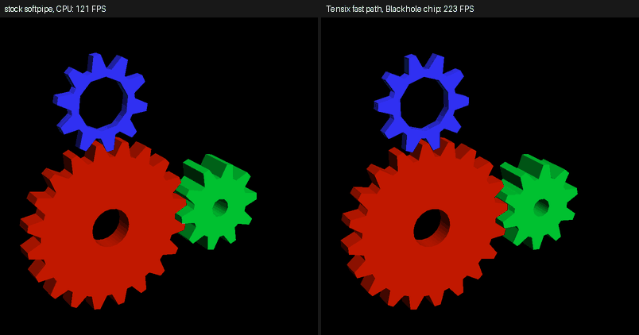

# OpenGL through Mesa: the softpipe Tensix fast path

Mesa's `softpipe` (the reference software driver of the Gallium stack) gets a fast path that hands the rasterization
of whole frames to tt-raster: a Blackhole chip, or the CPU reference backend of the same pipeline. Mesa does
everything else: the OpenGL frontend (GL 3.3 compatibility profile as built here), GLSL and fixed-function state
to shaders, vertex shading, clipping, viewport transform and culling (Gallium's `draw` module on the host).

This is not a new driver and not Vulkan. It makes a subset of OpenGL fast, and everything outside the subset runs on
softpipe, unchanged and correct.

## What takes the fast path

A draw is accepted when all of this holds, otherwise softpipe draws it (after rendering and writing back what the
fast path has collected so far; the rest of that frame then runs on softpipe):

| Area | Accepted |
| --- | --- |
| Primitives | triangles, strips, fans, quads, polygons; no lines or points, no geometry shader, no stream output |
| Vertex stage | anything (fixed function, GLSL vertex shaders): it runs on the host in Mesa's draw module |
| Fragment shader | a colour pass-through: `gl_FragColor = varying` (what fixed-function rendering and `lighting in the vertex shader` produce); colours interpolated smooth (perspective-correct), flat, or linear; no kill, no depth write, no textures, no arithmetic |
| Framebuffer | one 8-bit unorm RGBA/BGRA colour buffer (not sRGB) and a depth buffer (Z24S8, Z24X8, S8Z24, X8Z24, Z32, Z32F, Z16), single sample, at most 2048 x 2048 |
| Depth | test LESS, LEQUAL or ALWAYS, or off (then nothing is tested or written); depth writes on or off per draw; no stencil, no alpha test, no depth bounds |
| Blending | equation ADD with (SRC_ALPHA, ONE_MINUS_SRC_ALPHA), (ONE, ONE), (SRC_ALPHA, ONE), (ONE, ONE_MINUS_SRC_ALPHA) or (DST_COLOR, ZERO), the same factors for RGB and alpha; RGBA colour mask. Refused: other factors, separate alpha factors, logic op, colour write masks, two-sided colour, scissor, polygon stipple/smoothing, queries |
| State changes | depth function, depth writes and blending can change between draws of a frame: every triangle carries its state to the rasterizer (draws stay in API order) |
| Frame structure | a frame starts with a full colour+depth clear; draws before it run on softpipe |

A frame is collected, rendered once when something needs the pixels (a buffer swap, `glFlush`/`glFinish`, a read-back,
a different framebuffer, a draw the fast path refuses) and written straight into the colour buffer's memory. The depth
buffer is written lazily: only when something reads it (a softpipe draw, a CPU read, a framebuffer change, a partial
clear); in the usual loop (draw, swap, clear) the clear drops it unwritten.

GLSL is therefore available for vertex shading (any GLSL vertex shader works) and for pass-through fragment shaders.
Fragment shaders with arithmetic are not yet translated to Tensix (the plan's G.6: NIR to SFPI); they run on softpipe.

## Files

- `softpipe_tensix/sp_tensix.{c,h}`: the fast path (new files in `src/gallium/drivers/softpipe`, MIT like Mesa).
- `patches/0001-softpipe-tensix-fast-path.patch`: the hooks (clear, draw, triangle setup, flush, framebuffer change,
  texture map; the `tensix` driver name; the `meson.build` entry). Applies to Mesa tag `mesa-26.3.0`.
- `tests/gl_scene.c`: a deterministic fixed-function / GLSL scene; `tests/compare_ppm.py`: image comparison.
- `../scripts/build_mesa.sh`, `../scripts/run_gl.sh`, `../scripts/test_gl.sh`.

The rasterizer is reached through `libttraster.so` (`include/ttraster/ttraster.h`, "Raster API": `ttr_context_create`,
`ttr_frame_begin`, `ttr_frame_triangles`, `ttr_frame_end`), loaded with `dlopen` so Mesa's build does not depend on
tt-metal. Perspective-correct colours are interpolated by the rasterizer itself (colour * 1/w and 1/w are interpolated,
the device multiplies by a Newton-refined reciprocal; see docs/FINDINGS.md).

## Use

```
scripts/build_mesa.sh                       # clones Mesa, applies the patch, builds softpipe + GLX, installs
scripts/run_gl.sh 5 glxgears -geometry 1920x1080
scripts/run_gl.sh 5 --backend off glxgears  # same Mesa, stock softpipe, for comparison
scripts/run_gl.sh 5 --backend reference ... # the fast path on the CPU backend (no chip)
scripts/test_gl.sh                          # image comparisons (TT_METAL_HOME set: also on a chip)
```

Environment: `TTR_GL=tensix|reference` turns the fast path on (`GALLIUM_DRIVER=tensix` is an alias for tensix),
`TTR_GL_CHIPS` sets the chip count, `TTRASTER_LIB` the path of `libttraster.so`, `TTR_GL_DEBUG=1` logs every
decision and per-frame timings. `GL_RENDERER` reads `tensix (softpipe)` when the path is on.

## Results

`scripts/test_gl.sh` renders a scene (smooth, flat, perspective, fan, strip, GLSL, lighting, culling, depth-tested
follow-up draws after a read-back) with stock softpipe, the fast path on the CPU backend and on a chip:

- Against stock softpipe about 1.5 to 2 % of the pixels differ by one colour level (rounding) and 0.01 to 0.03 % by more
  (pixels on triangle edges, where the two rasterizers resolve the fill rule differently); depth buffers agree the same way.
- CPU backend against chip: identical except perspective colours, where 0.6 % of the pixels differ by one level.
- Refused draws (blending, an arithmetic fragment shader) give the stock result exactly or within the same edge noise.

Speed (glxgears, Xvfb, one x8 chip, stock softpipe is single-threaded on this host): 300 x 300 575 FPS stock and
310 FPS on Tensix (a frame costs about 2 ms of fixed chip latency), 1024 x 1024 79 and 173 FPS, 1920 x 1080 31 and 126 FPS
(`docs/PERF.md`).



## Limits and what comes next

Whole-frame batching assumes the usual loop. Missing for conformance-grade OpenGL: textures (Tensix has no texture units),
stencil (the eight Dest planes are full), MSAA, lines and points, arithmetic fragment shaders (G.6), other blend factors
and separate alpha factors (a table row each), colour write masks, scissor. Vulkan is a different frontend (lavapipe) and
is not covered.
